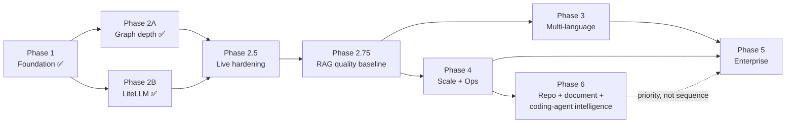

# 🗺️ Roadmap — Sequenced Delivery Plan

> [!abstract] How to read this
> Five phases, each shippable and independently valuable. Every item references a fully specified work package (WP) in the plan documents — hand the WP section directly to Codex (GPT-5.5) or Claude Sonnet 5 as the task brief, together with the ground rules from [[00-Audit-Overview#📐 How the work packages are written|the overview]]. Checkboxes are Obsidian tasks — track progress here.

## Phase 1 — Fix the foundation (1–2 weeks)
*Theme: the graph tells the truth, and ingestion doesn't melt.*

- [x] [[02-Graph-Depth-Analysis#WP-G1 — Async functions + richer metadata|WP-G1]] Async functions + metadata + rstrip bug (fixes F-01, F-05)
- [x] [[01-Codebase-Audit-Findings#F-12 · Graph traversal starts from ONE arbitrary seed|F-12]] Multi-seed traversal (one-liner class of fix, big quality win)
- [x] [[04-Scalability-Plan#WP-S1 — Make graph build O(N)|WP-S1]] O(N) graph build + ignore semantics + benchmark harness
- [x] [[04-Scalability-Plan#WP-S2 — Batch embedding + persistence|WP-S2]] Batch embedding/persistence, kill dual-write
- [x] [[04-Scalability-Plan#WP-S3 — Transactional, bulk graph persistence|WP-S3]] Atomic bulk persistence + per-repo lock
- [x] [[04-Scalability-Plan#WP-S4 — ANN index + query-path hygiene|WP-S4]] HNSW index + real filter columns (typed filter columns landed later as WP-S4B)
- [x] [[05-Enterprise-Platform-Plan#WP-E2 — Deployability images, config, CI|WP-E2 (CI part)]] Working CI (F-17) — do early so all later WPs land gated

**Exit criteria:** benchmark repo (2k files) ingests < 2 min; vector search uses index; CI green on every PR. **Met** — see `DOCS/test_results/Phase-1-Exit-Report.md`.

## Phase 2 — Graph depth + LLM freedom (2–3 weeks, two parallel tracks)
*Theme: answers get materially better.*

**Track A — graph (sequential):**
- [x] [[02-Graph-Depth-Analysis#WP-G3 — Remove CALL nodes from identity space; keep call sites as evidence|WP-G3]] Call-site model fix (F-03)
- [x] [[02-Graph-Depth-Analysis#WP-G2 — Materialize `IMPORTS` edges|WP-G2]] IMPORTS edges (F-02)
- [x] [[02-Graph-Depth-Analysis#WP-G4 — Scope- and import-aware call resolution (implement ADR-032 fully)|WP-G4]] Real call resolution (F-04)
- [x] [[02-Graph-Depth-Analysis#WP-G5 — `INHERITS` and `OVERRIDES` edges|WP-G5]] Inheritance edges
- [x] [[02-Graph-Depth-Analysis#WP-G6 — Traversal layer catches up with the deeper graph|WP-G6]] Traversal strategies catch up

**Track B — LLM (independent, small):**
- [x] [[06-LLM-Provider-LiteLLM-Plan#WP-M1 — LiteLLM core swap|WP-M1]] LiteLLM swap
- [x] [[06-LLM-Provider-LiteLLM-Plan#WP-M2 — Resilience fallbacks, retries, timeouts|WP-M2]] Fallbacks/retries
- [x] [[06-LLM-Provider-LiteLLM-Plan#WP-M5 — Model switching in the product surface|WP-M5]] Model picker
- [x] *(beyond original scope)* Multi-endpoint routing shipped in PR #47 — env-activated Tailscale Ollama default with fallback chain; Groq/NVIDIA NIM first-class support tracked separately as issue #46

**Exit criteria:** "what calls X" correct on eval fixtures incl. methods & cross-file; any cloud model usable by alias. **Met.**

## Phase 2.5 — Live hardening (unplanned, reactive; shipped 2026-07-19/20)
*Theme: bugs that only surfaced once the merged stack ran end-to-end in Docker.*

- [x] Issue #30 (5 parts): repo_id dropped in the query path, caller routing, context caps, source labels, repo metadata
- [x] PR #40: sources resolving to UUIDs instead of names (nested `metadata.source_metadata` bug)
- [x] PR #42: fallback-chain timeout regression from the LiteLLM swap (503s on CPU Ollama)
- [x] PR #47: multi-endpoint LiteLLM routing (Tailscale remote Ollama default + fallback)
- [x] Finish the remaining live-smoke-test acceptance items before starting Phase 3/4 work (issue #48, closed 2026-07-20):
  - [x] Subclass/override graph expansion firing correctly at low `top_k` — found and fixed a real bug (module/class-level seed mismatch broke `INHERITS`/`OVERRIDES` traversal), PR #51
  - [x] Two-repository source isolation (no cross-repo leakage) — verified clean
  - [x] Model-alias switching (default vs. explicit `ollama/...`, forced fallback via `model=smart`) — verified correct
  - [x] Gradio UI visual pass (labels, model dropdown, model-used line) — confirmed via screenshot

**Exit criteria met.** Also surfaced and filed issue #52 (Dockerfile `CMD` ignores the dev bind-mount, so `restart` never picks up code edits — only a rebuild does; closed 2026-07-20, PR #54) and, while verifying that fix live, issue #41 (each of `ingestion_service`/`llm_service`/`rag_orchestrator` resolves its own uv environment fresh at every container start instead of baking it into the image — still open). Investigating #41 surfaced two further, independently-closable bugs: issue #55 (`rag_orchestrator` resolving the CUDA-enabled `torch` build instead of CPU-only — closed 2026-07-21, PR #56) and issue #57 (the same latent gap in `ingestion_service`, plus a `torchvision` ABI mismatch found while fixing it — closed 2026-07-21).

## Phase 2.75 — RAG quality baseline (empirical, precedes any Phase 4 reranker work)
*Theme: prove the system retrieves the right evidence and answers well before changing anything else.*

- [x] [[08-RAG-Quality-Evaluation-Methodology#0 · Recommended execution order (WP-Q0)|WP-Q0]] Build curated eval corpus + run the unified chunking/retrieval/generation pass, classify every failure (tracked as issue #49)
- [x] Reranker go/no-go decision recorded per [[08-RAG-Quality-Evaluation-Methodology#4 · Reranker decision gate|the decision gate]]

**Exit criteria met — verdict: NO-GO on the reranker.** 9/10 known-answer
questions passed end-to-end against `shared/smoke_repo` + 3 docs; the one
failure classified `top-3-but-poor-answer` (confirmed via clean-context test
as a context-composition/distractor problem, not retrieval or generation
capability) — zero questions landed in the rank-8-20 bucket a reranker could
address. Next lever: prompting/context assembly, not `WP-S8`'s reranker
(implemented 2026-08-30 as issue #79 — see below).
Recall@5 measured at 70% via raw vector similarity alone vs. 90% via
production's actual path (graph expansion recovers two of the three misses)
— direct empirical evidence for the graph-aware architecture. Full evidence:
`DOCS/test_results/2026-08-27-wp-q0-rag-quality-baseline.md`. Also surfaced
and filed issue #64 (code-query seed search's `doc_type` filter never
matches its intended value, silently falling back on every code query) and
issue #65 (near-duplicate chunk crowding from module/sole-child artifact
embedding — a retrieval-quality/indexing finding, not a correctness bug).
Neither fixed as part of WP-Q0, per its evaluation-only scope — **both since
fixed** (2026-08-29): issue #64 in [#72](https://github.com/sankar-ramamoorthy/rag-foundry-universal/pull/72),
issue #65 in [#73](https://github.com/sankar-ramamoorthy/rag-foundry-universal/pull/73).
The Q7 next-lever finding itself (context-assembly conflation) is also
since fixed (2026-08-30): [issue #79](https://github.com/sankar-ramamoorthy/rag-foundry-universal/issues/79),
per-chunk source labeling in the assembled prompt.
See [[00-Audit-Overview]]'s 2026-08-30 status.

**Exit criteria:** every eval-corpus failure is classified (chunking/retrieval/filtering/ranking/generation); `WP-S8`'s reranker sub-task in Phase 4 either proceeds with evidence or is explicitly deferred with a recorded reason.

## Phase 3 — Multi-language (4–6 weeks)
*Theme: the headline feature.*

- [x] [[03-Multi-Language-Graph-Plan#WP-L1 — IR + GraphAssembler refactor (the enabler)|WP-L1]] IR + GraphAssembler (absorbs Track A learnings) — done 2026-08-30, issue #81
- [x] [[03-Multi-Language-Graph-Plan#WP-L2 — tree-sitter runtime + TypeScript/JavaScript extractor (first new language)|WP-L2]] TypeScript/JavaScript — done 2026-08-30, issue #83 (`specs/002-typescript-js-extractor/`)
- [x] [[03-Multi-Language-Graph-Plan#WP-L3 — Rust extractor|WP-L3]] Rust — done 2026-09-14, issue #130, PR #131
- [x] [[03-Multi-Language-Graph-Plan#WP-L4 — Java extractor|WP-L4]] Java — done 2026-09-14, issue #132, PR #133
- [~] [[03-Multi-Language-Graph-Plan#WP-L6 — Query/UI awareness of language|WP-L6]] Language filters — **retrieval-filter half done** as WP-L6a (issue #85, 2026-08-31), pulled forward ahead of WP-L3/L4 to validate WP-L2 against a real mixed-language repo; Gradio dropdown half still open
- [x] [[03-Multi-Language-Graph-Plan#WP-L5 — Python on tree-sitter (parity migration, last)|WP-L5]] Python parity migration — done 2026-09-14, issue #134, PR #135

**Exit criteria:** a polyglot fixture monorepo (py+ts+rs+java) ingests into one graph; language-filtered queries work; golden-file determinism suite green.

## Phase 4 — Scale + operate (3–4 weeks, parallel with late Phase 3)
*Theme: survives real repos and real ops.*

### Production correctness priority track (2026-09-16)

The [September 16 audit](/DOCS/audit/2026-09-16-repository-architecture-audit.md)
adds these release-blocking work packages. Their
[specification](/specs/005-production-correctness/spec.md),
[delivery plan](/specs/005-production-correctness/plan.md) and
[handoff](/specs/005-production-correctness/HANDOFF.md) are the continuation
entry points. Priority order is not a strict dependency chain; independent
health/readiness corrections can ship while memory validation is prepared.

> [!note] Checkboxes corrected 2026-10-12
> WP-R1-R7 below were left unchecked despite their issues having been
> closed since 2026-09-18 — confirmed directly against live GitHub state.
> "Closed" is the issue-tracker fact; it is not the same claim as "every
> mandatory live gate passed" (see `HANDOFF.md`'s completion ledger and
> [the spec's status line](/specs/005-production-correctness/spec.md) for
> that narrower bar) — the paragraph below this list already says as much
> and is unchanged.

- [x] WP-R1 — bounded ingestion memory, [#160](https://github.com/sankar-ramamoorthy/rag-foundry-universal/issues/160)
  (closed 2026-09-18); amended [004 spec](/specs/004-bounded-ingestion-memory/spec.md), planning PR #164.
- [x] WP-R2 — orphan recovery and admission, [#161](https://github.com/sankar-ramamoorthy/rag-foundry-universal/issues/161)
  (closed 2026-09-18); [tasks/rollout](/specs/005-production-correctness/issues/recovery.md),
  [ownership decision](/DOCS/adr/ADR-049-ingestion-ownership-recovery.md).
- [x] WP-R3 — ingestion/delete/serving consistency, [#166](https://github.com/sankar-ramamoorthy/rag-foundry-universal/issues/166)
  (closed 2026-09-18), related #144.
- [x] WP-R4 — evidence delivery and context truthfulness, [#167](https://github.com/sankar-ramamoorthy/rag-foundry-universal/issues/167)
  (closed 2026-09-18), related #91/#141/#145/#149/#156.
  Code merged to main via PR #192 (2026-09-18); [mechanics verification](/DOCS/test_results/2026-09-17-wp-r4-evidence-delivery.md)
  and [quality evaluation](/DOCS/test_results/2026-09-18-wp-r4-quality-evaluation.md) both complete, net positive.
  Production/deployment validation remains a separate #171 gate.
  September 17 follow-up: [#176](https://github.com/sankar-ramamoorthy/rag-foundry-universal/issues/176)
  tracks zero ANN results after bulk-delete churn reproduced in CI, **still open**;
  [plan](/specs/005-production-correctness/issues/post-delete-ann.md), production impact unverified.
- [x] WP-R5 — source pinning and generation-aware graph cache, [#168](https://github.com/sankar-ramamoorthy/rag-foundry-universal/issues/168)
  (closed 2026-09-18).
- [x] WP-R6 — healthcheck correctness and runtime provenance, [#169](https://github.com/sankar-ramamoorthy/rag-foundry-universal/issues/169)
  (closed 2026-09-18). Implementation merged in PR #172 with green CI; Linux gates pending:
  [evidence](/DOCS/test_results/2026-09-16-healthchecks-provenance-issue-169.md).
- [x] WP-R7 — bounded blocking-I/O isolation, [#170](https://github.com/sankar-ramamoorthy/rag-foundry-universal/issues/170)
  (closed 2026-09-18).
- [ ] WP-R8 — current Linux full-lifecycle release validation, [#171](https://github.com/sankar-ramamoorthy/rag-foundry-universal/issues/171)
  (**open** — the one remaining unchecked item in this track).

Each work package has its own implementation PR, acceptance evidence and KB
updates. Code merged is not production validated. Do not mark this track
complete until pinned memory, recovery, clean retrieval evaluation and current
Linux ingest/query/delete/redeploy gates pass. September 12 was a successful
controlled release; WP-R8 verifies the current revision, not a first-ever one.
Related, still-open follow-ups split out of this track: [#176](https://github.com/sankar-ramamoorthy/rag-foundry-universal/issues/176)
(post-delete ANN recall, above), [#180](https://github.com/sankar-ramamoorthy/rag-foundry-universal/issues/180)
(ingestion source-revision provenance), [#181](https://github.com/sankar-ramamoorthy/rag-foundry-universal/issues/181)
(evaluation three-revision provenance), and [#191](https://github.com/sankar-ramamoorthy/rag-foundry-universal/issues/191)
(deployment schema-compatibility gate).

### Existing scale and operate work

- [x] Production Docker Compose release discipline (unplanned operational
  hardening): `prod-2026-09-12` deployed from
  `202d91b34ee18e21c1dbb625d72acf9b82bce16d` with CI-green main SHA,
  self-contained application images, no production application source bind
  mounts, OCI provenance labels, persistent Postgres preservation, health checks,
  RAG smoke validation, rollback awareness, and release records. The failed
  predecessor `827c9cdc182073966f0b794968f90a7dc4388d18` is recorded as a failed
  promotion; issue #96 fixed the narrow `rag_orchestrator` image-packaging
  defect. Issue #41 remains deferred to Phase 5/WP-E2.
- [ ] [[04-Scalability-Plan#WP-S5 — Job queue for ingestion|WP-S5]] Job queue (arq + Redis) — see Phase 6 [#205](https://github.com/sankar-ramamoorthy/rag-foundry-universal/issues/205)
- [ ] [[04-Scalability-Plan#WP-S6 — Incremental ingestion (the massive-repo unlock)|WP-S6]] Incremental ingestion + snapshot lineage — now Phase 6 priority 1, [#196](https://github.com/sankar-ramamoorthy/rag-foundry-universal/issues/196)
- [ ] [[04-Scalability-Plan#WP-S7 — Bounded graph service instead of whole-graph-in-RAM|WP-S7]] Traverse endpoint, kill whole-graph RAM cache — see Phase 6 [#206](https://github.com/sankar-ramamoorthy/rag-foundry-universal/issues/206)
- [ ] [[04-Scalability-Plan#WP-S8 — Retrieval quality/perf at scale|WP-S8]] Concurrent fetch, real tokenizer, reranker flag (reranker sub-task gated on Phase 2.75's eval — see above)
- [ ] [[05-Enterprise-Platform-Plan#WP-E1 — Security baseline (do first, small)|WP-E1]] Security baseline *(can and should be pulled earlier if anything is network-exposed)* — see Phase 6 [#208](https://github.com/sankar-ramamoorthy/rag-foundry-universal/issues/208)
- [ ] [[05-Enterprise-Platform-Plan#WP-E5 — Observability|WP-E5]] Observability
- [ ] [[06-LLM-Provider-LiteLLM-Plan#WP-M3 — Streaming|WP-M3]] Streaming
- [~] [[06-LLM-Provider-LiteLLM-Plan#WP-M4 — Cost & usage telemetry|WP-M4]] Cost & usage telemetry — per-request logging/response field shipped 2026-09-13; Grafana dashboard and persisted usage rows still depend on WP-E5/WP-E3
- [x] *(beyond original scope)* [[06-LLM-Provider-LiteLLM-Plan#WP-M6 — Dynamic model catalog (2026-09-13, shipped)|WP-M6]] Dynamic model catalog and [[06-LLM-Provider-LiteLLM-Plan#WP-M7 — Runtime-persisted model policy (2026-09-13, shipped)|WP-M7]] runtime-persisted model policy — issue #46 follow-up (PRs #118/#119), closing out the Groq/NVIDIA NIM/OpenRouter first-class support originally deferred there
- [x] *(beyond original scope)* [[06-LLM-Provider-LiteLLM-Plan#WP-M8 — Transient-error-aware retry/backoff (2026-09-13, shipped, issue #125)|WP-M8]] Transient-error-aware retry/backoff (issue #125, PR #126) — prompted by live verification of the free providers WP-M6/M7 exposed: OpenRouter's free tier works end-to-end, Groq's is usable but rotates which model is up, NVIDIA NIM is currently broken (issues #122 config staleness, #123 fallback-error masking, #124 stale local-Ollama fallback model — see `DOCS/notes/20260913-free-provider-live-verification.md`). Also landed the same day: issue #120 (direct `run_rag()` raw-model passthrough, PR #121), the acceptance criterion that made this live verification possible from a script instead of only the HTTP API.

**Exit criteria:** 1M-LOC monorepo cold-ingests < 30 min; 1-file PR re-ingests < 30 s; traces + dashboards live; nothing unauthenticated.

## Phase 5 — Enterprise product (5–8 weeks)
*Theme: something a team can buy and log into.*

- [ ] [[05-Enterprise-Platform-Plan#WP-E2 — Deployability images, config, CI|WP-E2 (deploy part)]] Helm/K8s deployment + reproducible builds (issue #41: bake each service's own `uv` env into the image at build time instead of re-resolving at container start; fix the malformed compose healthchecks)
- [ ] [[05-Enterprise-Platform-Plan#WP-E3 — Identity & multi-tenancy|WP-E3]] OIDC + teams + repo grants + audit log — see Phase 6 [#208](https://github.com/sankar-ramamoorthy/rag-foundry-universal/issues/208)
- [ ] [[05-Enterprise-Platform-Plan#WP-E4 — Private git-host integration|WP-E4]] Private repos, then GitHub App + PR comments *(the vision-doc killer feature)* — see Phase 6 [#208](https://github.com/sankar-ramamoorthy/rag-foundry-universal/issues/208)
- [ ] [[05-Enterprise-Platform-Plan#WP-E6 — Product web UI (replace Gradio)|WP-E6]] React web UI with streaming + graph explorer — see Phase 6 [#208](https://github.com/sankar-ramamoorthy/rag-foundry-universal/issues/208)

**Exit criteria:** demo flow — SSO login → connect private polyglot repo → nightly incremental ingest → PR opened → bot comments callers-of-changed-code → dev asks follow-ups in web UI with model of choice.

## Phase 6 — Repository, document, and coding-agent intelligence
*Theme: stop asking semantic top-k to reconstruct a repository, stop
re-processing what hasn't changed, and make repository evidence
consumable by both human users and external coding agents.*

> [!important] Two primary consumers (added 2026-10-12, reconciling
> [the roadmap-reorientation proposal](/DOCS/proposals/2026-10-11-roadmap-reorientation-agent-ready-intelligence.md))
> RAG-FOUNDRY-UNIVERSAL has two long-term consumers of the evidence this
> phase builds: **human users** exploring repositories and documents
> through questions, traces, architecture views, and grounded
> explanations; and **coding agents** consuming structured,
> machine-readable evidence to investigate bugs, understand dependencies,
> assess changes, and eventually propose fixes. This has implications for
> API contracts, source identities, provenance, uncertainty reporting,
> benchmarking, and MCP integration — MCP is an integration surface, not
> the underlying intelligence capability itself. **Core distinction:**
> retrieval relevance is not source authority; source discovery is not
> evidence delivery; evidence delivery is not answer correctness; bug
> localization is not proof a patch is correct. Each boundary needs
> explicit contracts and evaluation.

Numbered after Phase 5 in this document, but **priority-wise this phase's
first two items slot in immediately after Phase 4's red-star track, ahead
of most of Phase 5** — Phase 5 (enterprise product) has not started and
nothing here is blocked on it. The red-star production-correctness track
(WP-R1–R8 above) is substantially closed as of WP-R4/#167 (PR #192, ADR
acceptance PR #193, 2026-09-18): mechanics review found no defects, and
the frozen-question quality evaluation found WP-R4 net positive against
the legacy runtime with no blocking findings. This phase supersedes
[`specs/005-production-correctness/spec.md`](/specs/005-production-correctness/spec.md)'s
old placeholder line ("the blue-star product work remains deferred") with
an actual prioritized 13-item list, filed as GitHub issues #196-#208.
**2026-10-12 reorganization:** items 4-13 below are now grouped by the
workstream labels (R/A/D/E/O/P) from the roadmap-reorientation proposal,
instead of one flat list — every issue number, shipped checkbox, and
dated decision from the original list is preserved unchanged; nothing was
replaced or renumbered away. New sub-items (AG0-AG5, D0-D5 minus #204,
decision-model experiment) have **no GitHub issue filed yet** — do not
treat them as shipped APIs or preapproved work.

Ordering and design rationale are not repeated here — see each issue for
its problem statement, proposed direction, and prior-art links (the 2026-09-07
[repository-intelligence architecture audit](/DOCS/audit/2026-09-07-repository-intelligence-architecture-audit.md),
the [ORIENT/TRACE/IMPACT notes](/DOCS/notes/20260906-repository-understanding-trace-and-structural-artifacts.md),
[WP-S6](/DOCS/audit/04-Scalability-Plan.md) for incremental ingestion,
[09-Retrieval-Technique-Decision-Gates](/DOCS/audit/09-Retrieval-Technique-Decision-Gates.md)
for the evidence-gated retrieval-experiment discipline, and the 2026-10-04
research notes on [repository intelligence](/DOCS/research/2026-10-04-repository-intelligence-research-lessons.md),
[document intelligence](/DOCS/research/2026-10-04-document-intelligence-research-lessons.md),
and [evaluation method](/DOCS/research/2026-10-04-evaluation-and-experimental-method-lessons.md)
behind the 2026-10-12 reorganization).

### Shipped (items 1-3)

1. [x] Incremental ingestion + repository/file snapshot lineage — [#196](https://github.com/sankar-ramamoorthy/rag-foundry-universal/issues/196), shipped via PR #212-#214
2. [x] ORIENT — repository intelligence / structural inventory foundation — [#197](https://github.com/sankar-ramamoorthy/rag-foundry-universal/issues/197), shipped via PR #215 (+ orchestrator exposure #216/PR #218, relationship-metadata export #220/PR #222, service-topology facts #221/PR #223)
3. [x] TRACE / IMPACT bounded structural query modes — [#198](https://github.com/sankar-ramamoorthy/rag-foundry-universal/issues/198), shipped via PR #219

### R — Repository correctness and intelligence (items 4-5, 7-8 plus #251/#254/#243/#91 below)

**2026-10-12 priority decision:** park #254 by deliberate prioritization,
keeping its failed acceptance open and candidate unmerged/undeployed. The current
experimental sequence is completed research; preserve the regression gates and
[architectural requirements](/DOCS/notes/2026-10-12-issue-254-deferred.md).
C1 remains separate; #243 held-out evaluation is deferred and untouched. Immediate
focus moves to the [bounded D0 document baseline](/DOCS/evaluations/2026-10-12-document-rag-baseline.md),
then native PDF/scanned-document/complex-table evaluation, followed by a narrow
read-only agent/MCP evidence pilot. Broader scalability follows unless an
operational regression intervenes. This changes current
focus, not historical completion or issue membership in the workstreams.

- [ ] (item 4, next) **#200** — Bounded evidence-sufficiency loop for structural workflows. **Status corrected 2026-10-12: its own internal Stage A (mechanical bounded evidence sufficiency, internal sub-stages labeled `A0`-`A5` — unrelated to this phase's new `AG0`-`AG5` coding-agent items) has already shipped** (see [status](/DOCS/status.md)/[index](/DOCS/index.md)); the box above stays unchecked only because its full frozen live-evaluation gate remains open, not because no work has started — do not read `[ ]` here as "not begun." Next is a Stage C follow-up combining Stage A with #199. **Decided 2026-10-12: stays under R, not Coding-Agent Integration (AG3).** Evidence sufficiency is a foundational capability independent of consumer — it applies to ORIENT, TRACE, IMPACT, and ordinary RAG queries alike. AG3 (below) consumes #200 but does not own it, so the project does not build separate sufficiency logic for a human-facing chatbot and a coding agent. Reordering rationale (ahead of #199, decided 2026-09-19) below is unchanged.
- [ ] (item 5) **#199** — Source authority / subject / provenance model ([ADR-053](/DOCS/adr/ADR-053-source-authority-provenance-model.md), `status: proposed`, not yet implemented).
- [ ] (item 7) **#202** — Context/evidence survival improvements beyond WP-R4. **Parent workstream for #254** (below, unchanged relationship) — #202 addresses the broader problem of preserving authoritative evidence through the retrieval pipeline; #254 investigated one concrete instance of it.
- [ ] (item 8) **#203** — Architecture facts and derived views (also feeds P's derived-view work, below).
- [ ] **#251** (ORIENT correctness follow-up, separate from #240) — parse Compose `!override` and verify the effective production inventory against the ordered base-plus-overlay configuration. Focused fixtures/acceptance checks defined before implementation; does not change this phase's ordering.
- [ ] **#254** (evidence-delivery diagnostic follow-up, linked to parent **#202**) — defines separate acceptance criteria for exact-symbol candidate discovery and attribution of individual chunk limits. **Normal-mode symptom: production-verified resolved (2026-10-11/12).** #257 (structural discovery, [PR #258](https://github.com/sankar-ramamoorthy/rag-foundry-universal/pull/258)) and a context-allocation priority fix ([PR #259](https://github.com/sankar-ramamoorthy/rag-foundry-universal/pull/259)) corrected two independent defects; `agent.py#Agent.run` now reaches final context and is directly cited by the live generated answer on the deployed stack — see [the production verification record](/DOCS/test_results/2026-10-11-issue-254-257-production-verification.md) ([PR #260](https://github.com/sankar-ramamoorthy/rag-foundry-universal/pull/260)). **#254 stays open** for two separate, unresolved questions: (1) the now-confirmed repository-overview explicit-code regression: the [October 12 matched control comparison](/DOCS/test_results/2026-10-12-issue-254-overview-control-comparison.md) completed 30 pinned requests. Overview questions improve from 1/8 to 8/8, but claim selection alone removes current `Agent.run` evidence for the explicit-path flow question and produces false code-absence answers; the no-code-regression gate fails. A [subsequent local policy candidate](/DOCS/test_results/2026-10-12-issue-254-policy-candidate.md) preserves the method and exact CLI evidence and all eight overview passes, but its 30-request answer gate still fails; it remains unmerged and undeployed. The [bounded loop-completeness diagnosis](/DOCS/test_results/2026-10-12-issue-254-loop-evidence-completeness.md) then verifies indexed provider/feedback passages outside the three-chunk artifact fetch cut and exact main/CLI passages excluded by byte capacity, with current file-level startup/CLI handoffs delivered; classification and settings remain unchanged. The [fixed-cap complete-evidence experiment](/DOCS/test_results/2026-10-12-issue-254-complete-evidence-experiment.md) fits all five normal-flow transition witnesses in 4024 evidence bytes and improves memory/feedback explanation to 3/3, but full factual/attribution acceptance is still 0/3; this manual oracle has state-dependency limits and implements no selector. The [separate coverage/grounding investigations](/DOCS/test_results/2026-10-12-issue-254-separated-investigations.md) also fail: a 3952-byte offline AST selection misses feedback/startup and branch relationships, and the frozen-evidence answer contract has no scored improvement with full-loop acceptance 0/3 in both arms. Candidate runtime files remain unchanged; dependency completion is still unresolved and #243 stays deferred. C1 grounding stays separate; (2) the historical deployed/local seed-set discrepancy for the same logical generation — embedding model, orchestrator code path, and ANN determinism were each individually ruled out as causes; **do not present inferred generation-retag drift as a demonstrated cause.** Use synthetic contract tests and pinned development-corpus replays under [ADR-054](/DOCS/adr/ADR-054-evaluation-dataset-isolation-and-generalization.md) before proposing further retrieval changes.
- [ ] **#243** — Evaluate repository-overview generalization on held-out repositories, under [ADR-054](/DOCS/adr/ADR-054-evaluation-dataset-isolation-and-generalization.md). At least one held-out corpus (self-repository, a separate Python project, a polyglot project, configuration-heavy cases where feasible); do not infer generalization from the self-repository alone.
- [ ] **#91** — Same-relation-type candidate overload truncates authoritative evidence past `MAX_EXPANDED_DOCS` (open since 2026-09-06, still unaddressed). Characterize recurrence before choosing an intervention, per issue #89's discipline.

**R exit gate:** predeclared case-by-case answer and exact-source obligations across multiple pinned repositories; negative and historical controls; baseline vs. candidate; acceptable latency/regression profile.

### A — Coding-agent integration and bug investigation (new 2026-10-12; no GitHub issues filed yet)

> Make coding agents a first-class external consumer of the repository-intelligence layer (R, above) — not a competing full coding agent by default. Sub-items below are labeled `AG0`-`AG5` (not `A0`-`A5`) to avoid colliding with #200's own, unrelated internal stage labels (`A0`-`A5`) referenced in [`DOCS/index.md`](/DOCS/index.md) and [`DOCS/status.md`](/DOCS/status.md).

- **AG0 — Agent-ready evidence contracts.** Additive, versioned machine-readable contracts (repository/snapshot identity, canonical symbol ID, file path/line/span, evidence type, relationship, role/authority facets, source hashes, confidence/unknown status, completeness/limits, causal trace IDs). Require source-revision agreement or an explicit mismatch warning before suggesting edit locations; preserve read-only default.
- **AG1 — Read-only MCP proof of value.** A small selected tool set (illustrative names only, not promised APIs: `orient_repository`, `find_symbols`/`get_symbol_evidence`, `trace_execution`, `analyze_impact`), reusing existing validated services rather than a broad new control plane. Gate: a real coding agent with/without the MCP, over matched source snapshots and permissions, shows measurable improvement — not merely successful tool invocation.
- **AG2 — Bug-localization benchmark.** Held-out, reproducible issue scenarios (bug report/failing test, known root cause, expected symbol/file, realistic distractors, source revision); compare the same agent with/without RAG-FOUNDRY-UNIVERSAL.
- **AG3 — Bounded retrieval repair and sufficiency.** Extends **#200** (owned by R, above — AG3 consumes it, does not own it) from structural endpoints to ordinary queries: at most one or a few bounded, targeted follow-ups, never unconstrained recursion. **#207** (deferred below) is reserved for adaptive multi-step investigation only after this measurably fails.
- **AG4 — Patch-impact analysis** (later, evidence-gated). Given a proposed diff: conservative structural impact plus unknowns; the calling agent still edits and runs tests.
- **AG5 — Evidence-backed fix proposals** (vision; not committed). Only after AG2/AG4 demonstrate quality; sandboxed execution and human review required.

### D — Document intelligence (parallel next tranche)

**Current Document Intelligence Quality workstream:** execute the twelve frozen
Markdown cases, diagnose blocking defects before expansion, then run a separately
frozen native-PDF/scanned-document/complex-table gate. Separate parser,
retrieval/context-survival and generation failures. The narrow MCP evidence pilot
follows these document gates. [Post-deployment preflight](/DOCS/test_results/2026-10-12-document-rag-post-deploy-preflight.md)
finds repository-ingested fixtures excluded by the document source-type filter;
the isolated local stack is now available but its
[first Markdown upload fails at the IR consumer](/DOCS/test_results/2026-10-12-document-rag-local-ingestion-blocker.md).
A narrow ingestion compatibility repair is the next blocking task before the
twelve questions. No answer-quality score is claimed, and removing the source
filter is not a proposed solution.

Existing: **#204** (JIT OCR / selective heavy-parse escalation) — related, but does not cover this whole track alone. New, unscoped (no issues filed): **D0** pinned document corpus/reliability baseline, **D1** bounded ingestion lifecycle (observable accepted/parsing/OCR/chunking/embedding/ready/failed stages — HTTP 202 is not success), **D2** structured page/block representation and provenance, **D3** structure-aware chunking, **D4** selective OCR/visual escalation, **D5** provider comparison and optional GPU isolation. See [Document Intelligence Research Lessons](/DOCS/research/2026-10-04-document-intelligence-research-lessons.md) for the evidence behind this sequencing (a real ingestion OOM/Exit 137 event, structure loss on a tabular screenshot via plain OCR, licensing/hardware constraints on GPU OCR candidates).

### E — Shared evaluation and experimentation (continuous, not a terminal phase)

- [ ] (item 6) **#201** — Evidence-driven retrieval experiments (keep the decision-gate process current) — already filed, unchanged.
- [ ] **E1 code-evidence experiment** (not to be confused with WP-E1, the security baseline; related to R's #202). Three separate questions, each its own issue and not to be combined: **#270** a trustworthy matched control replay (the full-graph timeout is unexplained; the event-loop fix #271/PR #272 is merged but not deployed and not shown to cure it), **#275** target-first selection (why a discovered target is lost before the final context), **#276** a statement-level delivery contract. Offline structural-context oracle result for #276: [source-faithful statements plus enclosing structure fit 4096 bytes in all six development cases, L1/L2 with only 170 bytes to spare; adding the data definitions they read exceeds the cap in three of six](/DOCS/test_results/2026-10-28-e1-structural-context-feasibility.md). Oracle evidence only; no selector built; no retrieval-policy merge authorized. The #276 [statement-level delivery contract](/DOCS/evaluations/code-evidence-e1/statement-level-contract.md) and [ADR-055](/DOCS/adr/ADR-055-node-text-read-endpoint.md) are **accepted, and the contract frozen, on 2026-10-28** (nothing implemented); the held-out repositories and cases (ADR-054) are planned but not yet chosen or written, and the GO pass rate is fixed by the frozen [GO-rate addendum](/DOCS/evaluations/code-evidence-e1/statement-level-contract-addendum-go-rate.md) (2026-10-28): at least 10 of 12 held-out cases passing the delivery gate, at least 5 wins over the unchanged control, at least 3 of 4 per repository, no regressions; delivery-only (answer correctness does not decide GO). The held-out [stratification and selection declaration](/DOCS/evaluations/code-evidence-held-out/stratification.md) (#281) is frozen before any repository is chosen; the owner is the independent second reviewer. Repositories selected by that rule on 2026-10-28 (pypa/hatch, pallets/werkzeug, pdfminer/pdfminer.six; [record](/DOCS/evaluations/code-evidence-held-out/selection-record.md)); 12 held-out cases written, independently reviewed and **frozen 2026-10-28** ([README](/DOCS/evaluations/code-evidence-held-out/README.md)); no held-out repository ingested or run yet.
- Required trajectory: `source → parser/extractor → index → vector/structural seed → graph expansion → candidate selection → chunk fetch → context survival → claim use in final answer`. Pin runtime/indexed-source/generation and retrieval/model/prompt/parser settings; freeze development and held-out sets before experiments; require GO/NO-GO/INVESTIGATE decisions; no PR/merge after a failed applicable quality gate. See [ADR-054](/DOCS/adr/ADR-054-evaluation-dataset-isolation-and-generalization.md) (first cross-link from this document) and [Evaluation and Experimental Method Lessons](/DOCS/research/2026-10-04-evaluation-and-experimental-method-lessons.md).
- **Decision-model experiment** (Jev/Laya/Kev/AnyJev/CLM): preserved as a **research candidate**, not a commitment or prerequisite. Begin in shadow mode if pursued; not synonymous with #207.

### O — Operations, scaling, and security (continuous; see also Phase 4's production-correctness track above)

- [ ] (item 10) **#205** — Durable ingestion/work execution (beyond orphan recovery).
- [ ] (item 11) **#206** — Bounded graph/query scaling.
- Confirm current status/evidence for #171, #176, #180, #181, #191 (Phase 4, above) before reprioritizing. The historical same-generation seed-set discrepancy noted under #254 (R, above) is still unresolved — do not claim lifecycle drift without new direct proof.

### P — Product experience and explanation (incremental, after evidence correctness)

- #203 (R, above) feeds derived architecture/trace views here; never let a generated diagram silently become independent source truth.
- New, unscoped: a focused evidence/graph explorer prototype before any wholesale Gradio replacement or enterprise UX; public educational material using #254/#257 as the worked example, distinguishing Claude Code's execution/investigation, ChatGPT's hypotheses/review, and the operator's authorization/deployment.
- Productization itself stays under #208 (deferred, below).

### Deferred, backlog slot only (items 12-13, unchanged)

12. [ ] General agentic repository investigator — [#207](https://github.com/sankar-ramamoorthy/rag-foundry-universal/issues/207) (AG3, above, must measurably fail first)
13. [ ] Enterprise/productization surface — [#208](https://github.com/sankar-ramamoorthy/rag-foundry-universal/issues/208) (P, above)

**Reordering rationale (#200 ahead of #199, decided 2026-09-19):** #199
(source authority/subject/provenance) and #200 (bounded evidence-
sufficiency loop) were originally sequenced #199-then-#200. #200 does not
actually depend on #199 landing first — a first version of the
sufficiency loop can operate on today's evidence signals alone (distinct
supporting chunks retrieved, requested symbol/entity resolved, whether
TRACE terminated in unresolved externals, whether retrieval truncated,
contradictory/missing evidence, whether required evidence reached final
context) without yet being able to judge authority-specific questions
(is this the authoritative source for the subject, are we mixing
evidence from different snapshots/source authorities, is this evidence
about the same logical subject the user asked about). Moving #200 first
gives an immediate behavioral upgrade — retrieval stops treating the
first result as final and checks whether evidence actually supports the
question, closer to "agentic RAG" while staying deterministic and
bounded (a hard iteration budget, mechanical sufficiency signals, no
LLM-judge dependency for the first version) — without waiting on #199's
larger provenance model. #199 still strengthens #200's sufficiency
semantics once it lands (a revisit pass adds authority/provenance-aware
checks on top of the mechanical ones), so #199 is not dropped, only
resequenced after #200's first version.

**Exit criteria:** items 1-2 have shipped code plus the same evidentiary
bar the red-star track used (mechanics review + measured evaluation, not
unit tests alone) before item 3 seriously starts. Items 12-13 stay out of
scope until items 2-5 and 7-8 have demonstrated concretely what bounded,
deterministic workflows cannot do — "agentic" is not a substitute for
fixing evidence quality, and productization is not what should dominate
this tranche. The same discipline now applies to AG3/AG2 relative to AG4/AG5,
and to D0-D3 relative to D4/D5.

### Next Evaluation Gate (provisional checkpoint, added 2026-10-12 — not a permanent roadmap commitment)

**Current checkpoint override:** D0 document baseline first. The overview
comparison below has completed research, while its applicable answer gate fails;
further #254 work and independent #243 execution are deliberately deferred.
The [D0 protocol](/DOCS/evaluations/2026-10-12-document-rag-baseline.md) has four
synthetic sources and twelve frozen questions; execution awaits corpus isolation.
That setup prerequisite is now resolved by the local evaluation stack; the
current blocker is the Markdown upload/IR contract failure recorded above.

A near-term planning checkpoint, not new backlog items — do **not** file a
GitHub issue for each line below automatically; let the evaluation itself
tell us which line turns into real implementation work worth its own
issue.

- [ ] Reconcile current issues, merged PRs, published status, and
  deployment verification against this phase's text; correct stale
  issue/roadmap claims.
- [x] Freeze an overview-policy explicit-code vs. global-overview control-case comparison and record a baseline (completed research; #254's answer acceptance still fails and follow-up is deliberately deferred, above).
- [ ] Prepare at least one independent-repository regression/held-out plan under [ADR-054](/DOCS/adr/ADR-054-evaluation-dataset-isolation-and-generalization.md) (feeds #243, above).
- [ ] Draft the AG0 machine-readable evidence contract (additive, no breaking API change) and identify one safe read-only MCP tool pilot (AG1).
- [ ] Define the agent A/B experiment (same checkout, source revision, tools/permissions, issue set, metrics) **before** building the AG1 integration.
- [ ] Start a D0 document-benchmark case inventory with OOM/table/layout cases. Initial four-source/twelve-question Markdown development baseline is frozen in the [D0 protocol](/DOCS/evaluations/2026-10-12-document-rag-baseline.md); PDF/OCR/layout/OOM cases remain unmeasured follow-up strata.
- [ ] Publish GO/NO-GO/INVESTIGATE decisions and issue mappings for the above, without silently expanding implementation scope.

**Exit criteria:** each checklist item above produces either a recorded decision (with evidence) or an explicit next experiment — not a default transition into unscoped implementation work.

---

## Dependency graph (phases)

> [!warning] Two rules that keep this roadmap honest
> 1. **Nothing ships without its benchmark/eval delta recorded** (`DOCS/test_results/`). Phase 1 builds the harness; every later WP reports against it.
> 2. **Graph-depth work after Phase 2 goes through the IR** ([[03-Multi-Language-Graph-Plan]]) — no more Python-only resolution code once WP-L1 lands.
> 3. **Phase 4's reranker sub-task (`WP-S8`) does not start until Phase 2.75 proves it's the actual bottleneck** — see [[08-RAG-Quality-Evaluation-Methodology]].

> [!note] Current next steps (2026-08-27)
> 1. ~~Finish the four remaining Phase 2.5 smoke-test items~~ — done, issue #48 closed.
> 2. ~~Run Phase 2.75's `WP-Q0` eval pass and record a reranker go/no-go decision~~ — done: **NO-GO on the reranker**, see Phase 2.75 above (issue #49, `DOCS/test_results/2026-08-27-wp-q0-rag-quality-baseline.md`).
> 3. Phase 3/4 work may resume — but `WP-S8`'s reranker sub-task specifically stays deferred per the NO-GO verdict. ~~The identified next lever is prompting/context assembly, tracked via issues #64 and #65~~ — #64 and #65 are done (2026-08-29, PRs #72/#73); ~~the remaining next lever is prompting/context assembly for chunks that share surface phrasing but describe different referents, not yet filed as its own issue~~ — done (2026-08-30, issue #79): chunks are now labeled by source in the assembled prompt.
> 4. ~~Issue #52 (dev bind-mount ignored by `CMD`)~~ — done, closed 2026-07-20 (PR #54). ~~Issue #55 (rag_orchestrator CUDA torch)~~ and ~~issue #57 (ingestion_service CUDA torch + torchvision ABI mismatch)~~ — done, closed 2026-07-21. Issue #41 (per-service uv env re-resolved fresh at every container start, plus the malformed compose healthchecks) stays open but is **deliberately deferred to Phase 5's `WP-E2` deploy part** (see below) — it's the "reproducible builds" work the WP already scopes, not urgent now that #55/#57 removed the multi-GB CUDA cost from every recreate.
> 5. ~~Phase 3 has begun: `WP-L1` ... Next: `WP-L2` (TypeScript/JS extractor), not yet started.~~ — done. `WP-L1` (issue #81, 2026-08-30) landed the IR + `GraphAssembler` refactor, verified behavior-identical against four real codebases pre/post-refactor. `WP-L2` (issue #83, 2026-08-30) shipped the TypeScript/JavaScript tree-sitter extractor. `WP-L6a` (issue #85, 2026-08-31) — the retrieval-filter half of `WP-L6` — was pulled forward to validate `WP-L2` against a real mixed-language repo, and shipped: `language` is a typed/indexed `vector_chunks` column, and `/v1/rag` accepts an optional `language` filter.
> 6. **RAG retrieval-quality follow-up, separate from the WP-Q0/reranker track (2026-09-06):** live diagnosis (`DOCS/test_results/2026-09-03-rag-retrieval-quality-linux-tailscale-baseline.md`) found graph expansion can correctly discover authoritative implementation evidence that then gets discarded by authority-blind ranking at the `MAX_EXPANDED_DOCS` cap. [Issue #89](https://github.com/sankar-ramamoorthy/rag-foundry-universal/issues/89) fixed this with relation-type-aware expansion ranking (`traversal_selector.py`), **confirmed on live data** (PR #90: a truncated target's rank moved from 24 to 12 and it now reaches final context; zero regressions across the rest of the live baseline questions). A distinct, still-open limitation — same-relation-type candidate overload, where ranking alone isn't enough to beat the cap — is tracked separately as [issue #91](https://github.com/sankar-ramamoorthy/rag-foundry-universal/issues/91). Next: characterize how often #91's pattern recurs before choosing an intervention (same discipline #89 used), and continue Phase 3 (`WP-L3` Rust or `WP-L4` Java next) independently — neither track blocks the other.
> 7. **Production hardening completed (2026-09-12):** `prod-2026-09-12` is deployed and tagged at `202d91b34ee18e21c1dbb625d72acf9b82bce16d`; release evidence lives in `DOCS/releases/2026-09-12-prod-release.md`. The next recommended work is retrieval observability/evidence-survival tracing before choosing further retrieval interventions.
> 8. **`WP-T1` done (2026-09-12):** [issue #100](https://github.com/sankar-ramamoorthy/rag-foundry-universal/issues/100), planning doc [[WP-T1-retrieval-evidence-trace]] — extended the existing `evidence_trace.py` instrumentation (issue #89/PR #90) into a complete, automatic, query-level evidence trace (trace ID, chunk-index detail, token-budget stage, final-context manifest) across PRs #102-#105. `WP-T1e`'s first live run ([DOCS/test_results/2026-09-12-wp-t1e-evidence-survival-run.md](/DOCS/test_results/2026-09-12-wp-t1e-evidence-survival-run.md)) found two clean cases of correct evidence reaching final context with generation still failing — the strongest signal yet that the next lever is generation reliability, not another retrieval-side fix — plus two follow-up issues, both now resolved: [#107](https://github.com/sankar-ramamoorthy/rag-foundry-universal/issues/107) (a real canonical-lookup URL-length bug, fixed in PR #109) and [#106](https://github.com/sankar-ramamoorthy/rag-foundry-universal/issues/106) (corpus self-contamination, resolved as a process decision — [DOCS/notes/20260912-self-ingestion-eval-corpus-policy.md](/DOCS/notes/20260912-self-ingestion-eval-corpus-policy.md)). Deliberately separate from Phase 4's `WP-E5 Observability` (generic ops tracing/metrics/logging) and from `08-RAG-Quality-Evaluation-Methodology`'s own `WP-Q1`/`Q2`/`Q3` naming (already used for chunking/retrieval/generation quality, executed as `WP-Q0`).
> 9. **Red-star track substantially closed; Phase 6 opened (2026-09-18):** WP-R4/#167 merged (PR #192) and its ADR accepted (PR #193) with a net-positive frozen-question quality evaluation — see [the quality evaluation](/DOCS/test_results/2026-09-18-wp-r4-quality-evaluation.md). Its one non-blocking follow-up is tracked as [#194](https://github.com/sankar-ramamoorthy/rag-foundry-universal/issues/194) (budget calibration — an evidence-gated experiment, explicitly not scheduled to run immediately). New Phase 6 above formalizes the 13-item post-R4 backlog as issues [#196](https://github.com/sankar-ramamoorthy/rag-foundry-universal/issues/196)-[#208](https://github.com/sankar-ramamoorthy/rag-foundry-universal/issues/208), superseding `specs/005-production-correctness/spec.md`'s old "blue-star work remains deferred" placeholder. Next up: Phase 6 items 1-2 (incremental ingestion + snapshot lineage, ORIENT) — status/README updates are a separate, explicitly deferred follow-on task, not part of this update.
> 10. **Phase 6 items 1-3 shipped (2026-09-19):** #196 (PR #214), #197 (PR #215) plus its orchestrator exposure ([#216](https://github.com/sankar-ramamoorthy/rag-foundry-universal/issues/216)/PR #218), #198 (PR #219), and two #197 fast-follows filed and shipped the same day — relationship-metadata graph-export preservation ([#220](https://github.com/sankar-ramamoorthy/rag-foundry-universal/issues/220)/PR #222) and mechanically derived endpoint/service/HTTP-call facts ([#221](https://github.com/sankar-ramamoorthy/rag-foundry-universal/issues/221)/PR #223) — are all merged to `main`, CI green throughout, each independently live-verified against this repo's own real services (not just unit tests). **Reordered #200 ahead of #199** (rationale above the exit-criteria section) — #200's next up, not #199.
> 11. **#254's normal-mode symptom fixed and Phase 6 reorganized into R/A/D/E/O/P (2026-10-12):** #257 (structural discovery, [PR #258](https://github.com/sankar-ramamoorthy/rag-foundry-universal/pull/258)) and a context-allocation priority fix ([PR #259](https://github.com/sankar-ramamoorthy/rag-foundry-universal/pull/259)) resolved #254's original normal-mode failure, production-verified in [PR #260](https://github.com/sankar-ramamoorthy/rag-foundry-universal/pull/260) — `agent.py#Agent.run` now reaches final context and is cited by the live generated answer. #257 closed; #254 stays open for the overview-policy and historical seed-set questions, above. Separately, reconciled [the roadmap-reorientation proposal](/DOCS/proposals/2026-10-11-roadmap-reorientation-agent-ready-intelligence.md) against live GitHub issue state, the OKF standard, and the three 2026-10-04 research notes (all read in full; internally consistent, no contradictions found) — **Option B approved**: Phase 6's items 4-13 (plus #251/#254) are now grouped under R/A/D/E/O/P workstream labels in place, every issue number and shipped checkbox preserved unchanged, new AG0-AG5/D0-D5/decision-model-experiment items added as explicitly unscoped (no issues filed; `AG`, not `A`, to avoid colliding with #200's own existing internal A0-A5 stage labels below), and a provisional "Next Evaluation Gate" checklist added (not a permanent commitment). #200 decided to stay under R, not AG3; #254 decided to stay linked to parent #202. The proposal document itself is now marked `status: integrated` and kept as the historical rationale record.
> 12. **Status-drift sweep (2026-10-12):** a follow-up audit of other docs for the same stale-status pattern found four confirmed cases, now corrected: (1) five foundational ADRs (ADR-032, ADR-043, ADR-044, ADR-045) still said `status: proposed` despite being fully implemented and depended upon for ~8 months — promoted to `accepted`; ADR-039 was superseded by ADR-040 (same date) rather than independently accepted — marked `superseded`. (2) `specs/005-production-correctness/spec.md`'s header said "Planned" and its work-package table had no status markers, despite `HANDOFF.md` and live GitHub state showing WP-R1-R7 (#160/#161/#166/#167/#168/#169/#170) all closed 2026-09-18 — header and table corrected, only WP-R8/#171 and split-off follow-ups #176/#180/#181/#191 remain open. (3) This document's own Phase 4 WP-R1-R7 checkboxes were left unchecked despite the same closures — corrected to `[x]`; WP-R8 stays `[ ]`, the one genuinely open item. (4) Phase 6's #200 entry (above, item 4) read as "not begun" — corrected to note its own internal Stage A has already shipped, with only the full live-evaluation gate still open. None of these four corrections change what work remains outstanding (WP-R8, #171, #176, #180, #181, #191, #199, #200's Stage C, #202-#208 are all still genuinely open) — they correct stale status text, not actual scope.

