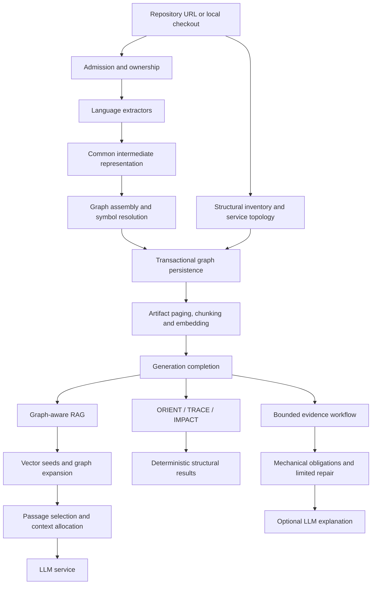

# Code intelligence architecture audit

> [!abstract] Verdict
> The subsystem has a credible foundation for repository intelligence, but its
> strongest guarantees are local to individual components. The main architectural
> weakness is carrying trustworthy generation, completeness, and source-fidelity
> guarantees through the entire request. A broader investigation layer would
> inherit those gaps. Preserve the shared IR, canonical graph, deterministic
> structural APIs and pure assessment functions; strengthen their connecting
> contracts before expanding into adaptive investigation.

## Scope, provenance, and evidence limits

Reviewed local source commit:
`4ba2387ecd51e869357d5d015b7c29b079da884d`.

Scope covers repository ingestion, extraction, graph construction, persistence,
vector retrieval, graph expansion, passage/context allocation, ORIENT, TRACE,
IMPACT, evidence assessment, and the generation boundary. Shared infrastructure
is considered only where it directly affects code intelligence. **Document
ingestion, OCR, and document-RAG quality are excluded at the owner's request.**

The review proceeded in three stages: independently reconstruct the actual
architecture from code; assess correctness, complexity, scalability and
alternatives; then produce prioritized findings and proposed investigations.
Earlier audits and the strategic note were comparison material, not assumptions
about current implementation.

Evidence labels:

- **Source:** inspected implementation and its call paths at the reviewed commit.
- **Probe:** executed actual functions locally with synthetic inputs or mocked
  collaborators, entirely in memory. These are not live service integration tests.
- **Historical:** a prior audit, decision or evaluation, not freshly reproduced.
- **Inference:** an architectural consequence or risk derived from source, not an
  observed production incident.

No application source, configuration, deployment, corpus, experiment artifact,
or candidate attempt marker was changed during the review. No services were
contacted, held-out questions executed, or held-out pools inspected. Full CI,
database integration tests, load tests and language-semantic certification were
not rerun for this audit. The owner subsequently requested this Markdown record
and its audit-index link; those documentation additions do not constitute an
implementation change.

The working tree at review time contained three pre-existing untracked files:
the strategic note, `scripts/code_evidence_prototypes.py`, and
`tests/test_code_evidence_prototypes.py`. The note is discussion input outside the
reviewed commit; neither prototype is treated as shipped runtime behavior.

Code links below use repository-relative Markdown paths with line references.
Line numbers describe the reviewed commit, not future revisions. This is a dated
assessment, not a live completion ledger; consult [Project Status](/DOCS/status.md)
for subsequent work. `status: complete` means the review is complete, not that
its findings have been resolved.

## Stage 1 — Architecture reconstructed from source

The implementation contains three distinct code-intelligence query paths:

| Boundary | Actual implementation | Primary source |
| --- | --- | --- |
| Admission and lifecycle | One global ingestion slot, database-backed ownership, repository mutation coordination, and abandoned-worker reconciliation. Execution still uses daemon threads. | [Admission](/ingestion_service/src/core/ingestion_ownership.py#L99), [worker lifetime](/ingestion_service/src/core/ingestion_jobs.py#L57) |
| Extraction | Python, TypeScript/JavaScript, Rust and Java extractors feed a common IR. Python retains an AST fallback. | [Extractor dispatch](/ingestion_service/src/core/codebase/repo_graph_builder.py#L43), [IR](/ingestion_service/src/core/codebase/ir.py) |
| Graph construction | Shared assembly assigns canonical identities and resolves containment, imports, calls, inheritance, overrides and supporting relationships. | [Graph assembler](/ingestion_service/src/core/codebase/graph_assembler.py#L71), [identity](/ingestion_service/src/core/codebase/identity.py) |
| Storage | Repository-scoped canonical identities; surviving document IDs are preserved, relationships replaced transactionally, and generation identity attached. | [Graph persistence](/ingestion_service/src/core/codebase/codebase_persistence.py#L103) |
| Incremental ingestion | The repository graph is rebuilt. Unchanged-file classification can avoid chunking and embedding: embedding reuse, not fully incremental graph maintenance. | [Build/persist](/ingestion_service/src/api/v1/codebase_ingest.py#L272), [reuse eligibility](/ingestion_service/src/api/v1/codebase_ingest.py#L354) |
| Repository RAG | Generation-filtered vector seeds, graph expansion, bounded artifact/passage fetching, chunk limits, optional policies/reranking, byte-budgeted context and generation. | [Hybrid retrieval](/rag_orchestrator/src/core/service.py#L879), [run_rag](/rag_orchestrator/src/core/service.py#L1199) |
| ORIENT | Deterministic inventory computed during ingestion and read from persisted generation metadata. | [Inventory](/ingestion_service/src/core/codebase/structural_inventory.py#L389), [ORIENT API](/ingestion_service/src/api/v1/orient.py#L62) |
| TRACE / IMPACT | Traversal of an in-memory repository graph, returning structured relationship evidence. | [Structural traversals](/rag_orchestrator/src/retrieval/trace_impact.py) |
| Evidence workflow | Explicit mechanical obligations. TRACE can perform one additional bounded traversal; this is not general adaptive investigation. | [Evidence workflow](/rag_orchestrator/src/retrieval/evidence_workflow.py) |
| Generation | An LLM service owns model resolution, prompt construction and provider fallback; the orchestrator supplies context and reports the resulting model identity. | [Generation boundary](/rag_orchestrator/src/core/service.py#L1517), [LLM client](/llm_service/src/core/llm_client.py#L60) |

### Decisions worth preserving

- **Language-neutral IR and shared graph assembly:** language support does not
  require a separate retrieval architecture for each language.
- **Deterministic structural APIs:** inventory and relationship evidence are
  available without an LLM.
- **External/unresolved symbols and relationship metadata:** a useful basis for
  communicating uncertainty, provided downstream consumers retain it.
- **Pure assessment separated from I/O:** the evidence workflow can be inspected
  and tested independently of service availability.
- **Retrieval stage traces and final-context manifests:** discovery and delivery
  losses can be distinguished instead of attributed generically to model quality.

These are useful foundations for the strategic note's repository-intelligence
platform. They do not by themselves prove complete language semantics, behavioral
understanding or answer correctness.

## Stage 2 — Critical assessment

### Classification and priority

- **Architectural defect/gap:** an interface, invariant or representation cannot
  establish the guarantee needed by its consumers.
- **Implementation bug:** behavior loses information or violates the intended
  local contract.
- **Technical debt:** implementation structure or operational cost impedes
  maintenance or scaling without necessarily producing an incorrect result.
- **Missing capability:** functionality required by a future use case but not
  currently promised or implemented. This is not automatically a defect.

P1 means investigate before depending on the affected guarantee for broader code
intelligence. P2 means important follow-up whose implementation should be governed
by measured requirements. These priorities are not production incident severity
ratings and do not reuse the July audit's severity scale.

| ID | Finding | Priority | Classification | Evidence |
| --- | --- | --- | --- | --- |
| CI-01 | Generation identity is not bound to the graph export/cache load | P1 | Architectural contract defect | Source + probe |
| CI-02 | Structural APIs can block the event loop during graph loading | P1 | Implementation bug | Source |
| CI-03 | Incremental reuse does not identify the complete transformation pipeline | P1 | Architectural correctness gap | Source + inference |
| CI-04 | IMPACT loses depth-limit information and some relationship bases | P1 | Implementation bugs | Source + probes |
| CI-05 | Extraction failures lack adequate per-file failure evidence | P1 | Implementation/observability defect | Source |
| CI-06 | Stored source can be absent from every embedding input | P2 | Retrieval representation defect | Source + probe |
| CI-07 | Resource limits do not bound the complete graph workload | P2 | Scalability debt | Source + inference |
| CI-08 | Structural sufficiency is not behavioral evidence sufficiency | P2 | Missing capability and contract ambiguity | Source |
| CI-09 | RAG policy composition and final-payload accounting need clearer boundaries | P2 | Technical debt and observability gap | Source |

### CI-01 — Generation identity is checked separately from the graph

The cache checks the current generation, fetches the graph by repository ID, and
stores the result under the earlier generation value. Graph export supplies
`generation_status`, but not the generation ID needed to attest its content.

A probe made the initial check return generation A and the loader return a graph
representing B. The cache returned **A alongside B's nodes**. The probe demonstrates
the missing binding with mocked collaborators, not an observed live rebuild race.

There is also a database boundary: graph nodes and relationships are read in
separate queries while surviving document IDs remain stable across rebuilds.
Without an explicit consistent snapshot or equivalent fencing, a rebuild can
intervene between those reads. This is a source-derived concurrency risk, not a
database integration result from this review.

Ordinary RAG and the evidence workflow have outer generation checks that mitigate
several races. Direct TRACE/IMPACT routes have weaker protection. This finding
does **not** assert that every RAG response mixes generations; the graph API/cache
contract itself is insufficient.

**Code:** [cache load/insertion](/rag_orchestrator/src/retrieval/codebase_utils.py#L263),
[graph export](/ingestion_service/src/api/v1/graph.py#L149),
[database graph read](/ingestion_service/src/core/db_utils.py#L532),
[outer generation verification](/rag_orchestrator/src/core/service.py#L521).

**Investigation:** define an export envelope containing the actual generation ID;
obtain nodes and relationships from a consistent snapshot; reject mismatches
before caching. Exercise rebuild/export interleavings in integration tests.

**Trade-off:** stricter checks may produce retryable failures during rebuilds.
Continuous availability requires staged generations, a substantially larger change.

### CI-02 — Async structural handlers perform blocking graph I/O

TRACE and IMPACT call synchronous cache functions from async routes. Their evidence
counterparts do the same. Even a warm cache performs a synchronous generation
request; a cold load calls `requests.get()` for the full graph without a timeout.
A slow ingestion service can therefore block the orchestrator event loop.

Ordinary RAG already offloads graph ranking with `asyncio.to_thread`; protection is
inconsistent across interfaces. This review establishes the blocking call path,
not its measured production latency.

**Code:** [direct structural routes](/rag_orchestrator/src/api/v1/routes.py#L161),
[evidence service](/rag_orchestrator/src/core/evidence_service.py#L211),
[full-graph request](/rag_orchestrator/src/retrieval/codebase_queries.py#L310),
[ordinary RAG offloading](/rag_orchestrator/src/core/service.py#L1004).

**Investigation:** use a delayed graph-service fixture while concurrently requesting
a lightweight orchestrator endpoint. Establish finite deadlines and a consistent
offloading policy.

**Trade-off:** thread offloading protects responsiveness but does not itself bound
memory, simultaneous graph loads or abandoned blocking work.

### CI-03 — Incremental reuse has an incomplete identity contract

Reuse eligibility compares file hashes, a chunker version, and an embedding
identity composed from provider/model name. It does not include extractor behavior,
source-rendering behavior or immutable embedding-model identity.

Unchanged repository bytes can consequently produce newly extracted artifact text
while retaining vectors/chunk text generated by a previous transformation. Model
tags can also refer to different model bytes over time. The implementation reparses
and persists the graph before selecting reused vectors, making the potential
node/passage mismatch consequential. This does not establish that every unchanged
file is currently mismatched.

**Code:** [reuse identity](/ingestion_service/src/api/v1/codebase_ingest.py#L354),
[reuse/retagging](/ingestion_service/src/api/v1/codebase_ingest.py#L239),
[chunker version](/shared/chunkers/selector.py#L11).

**Investigation:** hold source bytes constant and deliberately change extractor
output. Verify that node text, stored passages and embeddings remain coherent.
Assess transformation fingerprints or artifact-content comparisons.

**Trade-off:** conservative invalidation increases re-embedding cost. Versioned
transformations make that cost explicit and potentially selective.

### CI-04 — IMPACT underreports incomplete results

Two probes using the actual traversal functions established:

1. For `C → B → A`, queried in reverse from A at depth one, TRACE reports
   `depth_limited=True`. IMPACT returns B with `truncated=False`; its evidence
   assessment reports `satisfied` with no reason code.
2. With one candidate connected by CALL and IMPORTS and a candidate cap of one,
   IMPACT records only the CALL basis and stops before considering the second basis.

The first loses a meaningful scope warning. The second makes multiple-basis
retention conditional on remaining candidate capacity. The two-relation probe is
a synthetic contract test, not an assertion that this exact graph is common.

**Code:** [IMPACT traversal](/rag_orchestrator/src/retrieval/trace_impact.py#L310),
[TRACE depth reporting](/rag_orchestrator/src/retrieval/trace_impact.py#L248),
[IMPACT assessment](/rag_orchestrator/src/retrieval/evidence_sufficiency.py#L203).

**Investigation:** distinguish depth exhaustion, candidate-count truncation and
incomplete basis collection. Separately decide whether mixed-relation paths are
intended: currently each relation is traversed independently. Mixed-relation
investigation is a capability decision, not automatically another bug.

**Trade-off:** additional basis collection needs its own edge/work budget; raising
the candidate cap alone does not resolve the semantics.

### CI-05 — Extraction failure becomes insufficiently explained non-coverage

The builder catches exceptions from reading/extracting a file and continues.
Inventory records indexed/non-indexed counts but does not preserve these extraction
failure reasons in its gap list. Unsupported files, decoding failure and extractor
defects are therefore difficult to distinguish downstream.

During rebuild, previously indexed symbols from a now-failing file can disappear
from the new graph. A successfully completed ingestion should not be interpreted as
proof that every supported source file was extracted successfully.

The builder also reads a file twice: once for hashing and once for extraction.
A changing local checkout can therefore supply a hash and source text from different
bytes. Git-cloned ingestion and a stable local snapshot reduce this risk; arbitrary
local paths are not inherently immutable.

**Code:** [build loop](/ingestion_service/src/core/codebase/repo_graph_builder.py#L238),
[inventory coverage](/ingestion_service/src/core/codebase/structural_inventory.py#L389),
[replacement semantics](/ingestion_service/src/core/codebase/codebase_persistence.py#L103).

**Investigation:** synthetic parser/decoding failures and a changing-file fixture.
Specify per-file outcomes and a policy for publishing partial extraction.

**Trade-off:** aborting on every unsupported file is too strict. Explicitly
classified partial coverage is preferable to silently treating failure as absence.

### CI-06 — Stored source is not necessarily represented in embeddings

The large-artifact strategy emits 1,000-character windows with 100-character
overlap. The Ollama embedder truncates each input to 800 characters. A synthetic
marker placed in the resulting gap was present in stored chunks but absent from
every truncated embedding input.

This proves the marker contributes nothing to those vector representations. It
does not prove the artifact cannot be retrieved through other context or graph
relationships. Query text also passes through the embedder's truncation.

**Code:** [chunk selection](/shared/chunkers/selector.py#L37),
[window stepping](/shared/chunkers/text.py#L36),
[embedding truncation](/shared/embedders/ollama.py#L9).

**Investigation:** measure embedding-input coverage independently from stored-text
coverage, then compare aligned strategies on development fixtures.

**Trade-off:** changing this contract requires versioning and re-embedding.
Context reordering cannot repair an omitted embedding input.

### CI-07 — Result limits do not bound the complete workload

The embedding stage now pages artifacts and buffers batches, a substantial
improvement. Other allocations remain proportional to repository/graph size:

- Graph construction retains repository-wide extraction results and graph state.
- Incremental reuse accumulates a repository-wide provenance map.
- Graph export loads ORM nodes, including source text, before serializing a smaller
  response.
- Each orchestrator process caches whole graphs, bounded by repository count
  rather than bytes.
- Concurrent cache misses can load the same graph more than once.
- Traversal sorts a node's complete neighbor set before applying its output limit.

**Code:** [builder state](/ingestion_service/src/core/codebase/repo_graph_builder.py#L238),
[reuse accumulation](/ingestion_service/src/api/v1/codebase_ingest.py#L239),
[export query](/ingestion_service/src/core/db_utils.py#L532),
[cache](/rag_orchestrator/src/retrieval/codebase_utils.py#L230),
[neighbor processing](/rag_orchestrator/src/retrieval/trace_impact.py#L264).

**Investigation:** independently measure cold export, concurrent cold loads,
high-degree traversal, graph-build peak memory and incremental-reuse memory.
Passing the bounded-memory CI job is not proof of all of these properties.

**Trade-off:** start with narrower database projections, coalesced loads and
byte-aware cache admission. Server-side bounded traversal may eventually help;
this audit does not justify replacing storage with a new graph database.

### CI-08 — Structural sufficiency is not behavioral sufficiency

The evidence workflow checks facets, starts, targets and candidate sets. IMPACT
deliberately considers an empty or truncated candidate set mechanically satisfied.
Its optional explanation receives structural identities and reason codes, not the
source statements needed for a general implementation-behavior explanation.

Ordinary RAG retrieves source chunks but does not pass through this same sufficiency
controller. These paths are independently useful; they do not yet constitute the
strategic note's unified retrieve → identify gap → repair → answer architecture.
The documented narrow mechanical contract is not itself an implementation bug.

**Code:** [assessment contracts](/rag_orchestrator/src/retrieval/evidence_sufficiency.py),
[explanation rendering](/rag_orchestrator/src/core/evidence_service.py#L74),
[bounded repair](/rag_orchestrator/src/retrieval/evidence_workflow.py#L238).

**Investigation:** define separate contracts for structural reachability,
behavioral explanation and impact hypotheses. Specify required source regions,
relationships, fidelity and coverage for each.

**Trade-off:** a universal sufficiency score would obscure different obligations.
Start with a narrow behavioral contract before adaptive planning. Treat
[ADR-055](/DOCS/adr/ADR-055-node-text-read-endpoint.md) and the
[statement-level contract](/DOCS/evaluations/code-evidence-e1/statement-level-contract.md)
as governed design inputs, not evidence that the capability has shipped.

### CI-09 — Policy composition and payload accounting need clearer boundaries

The large RAG service combines retrieval, overview policies, allocation,
diagnostics and answer generation. Typed intermediate contracts would make
interactions easier to test than further expanding feature-flag combinations.

Overview policy text is prepended after the ordinary context budget and manifest
are computed. Those measurements therefore describe retrieved evidence, not the
complete LLM payload. This is an accounting boundary; no model context overflow
was reproduced in this review.

**Code:** [RAG orchestration](/rag_orchestrator/src/core/service.py#L1199),
[context accounting](/rag_orchestrator/src/core/service.py#L1428),
[policy prefix](/rag_orchestrator/src/core/service.py#L1492).

**Investigation:** trace the complete submitted context and distinguish evidence
budget, policy overhead, prompt overhead and model usage. Identify stable typed
boundaries before proposing a behavior-changing refactor.

**Trade-off:** a broad rewrite risks disturbing experimentally sensitive ordering.
Begin with explicit contracts and payload observations.

## Reconciliation with the July 9 and September 16 audits

The [July 9 audit](/DOCS/audit/00-Audit-Overview.md) and its
[codebase findings](/DOCS/audit/01-Codebase-Audit-Findings.md) describe an earlier
implementation. The [September 16 audit](/DOCS/audit/2026-09-16-repository-architecture-audit.md)
already records progress since then and identifies different critical paths.
Neither is a current defect list. Both remain valuable historical evidence.

### July 9 baseline

| Earlier finding or direction | Current source assessment | Residual qualification |
| --- | --- | --- |
| F-03: CALL nodes collide in canonical identity | Calls are held as call-site records and resolved into edges by the shared assembler. | This addresses the representation mechanism; it is not a fresh certification of all call resolution. |
| F-04 and graph-depth work: method/import/inheritance resolution | Shared assembly now has import, inheritance and call-resolution passes, external symbols and confidence metadata. | Static resolution is approximate; dynamic runtime reachability remains a separate question. |
| F-06/F-09: destructive non-atomic persistence and per-edge queries | Transactional bulk upserts/replacement and endpoint maps materially address these mechanisms. | Cross-service lifecycle and query snapshot guarantees remain distinct; see CI-01. |
| F-07: repeated graph lookups | Explicit entity and symbol indexes exist. | This review does not certify every graph-construction operation as linear; whole-graph memory remains. |
| F-11: unmanaged worker lifetime | Admission, ownership and reconciliation now wrap daemon-thread execution. | Durable resumable execution remains a missing capability, not the unchanged July defect. |
| F-12: one arbitrary traversal seed | Ordinary RAG extracts a seed set and passes it to expansion/ranking. | Expansion ranking and caps can still lose relevant candidates. |
| Multi-language plan | Python, TS/JS, Rust and Java extractors now share the IR/assembler. | Supported extraction is not full compiler semantics or proven cross-language query parity. |

The source review did not independently revalidate every July finding. For example,
it should not be read as an exhaustive re-certification of extractor parity or all
historical performance claims.

### September 16 baseline

| Earlier concern | Current source assessment |
| --- | --- |
| Uncontrolled ingestion admission and abandoned jobs | Materially addressed by locking, ownership and reconciliation. |
| Whole-repository embedding accumulation | Addressed in the embedding stage; graph and reuse-map memory remain separate concerns. |
| Indefinitely stale repository-only cache | Improved by generation checks and LRU eviction; graph export/load binding remains incomplete. |
| Vector retrieval without generation filtering | Outdated for ordinary code RAG: current seed and passage requests carry generation identity. |
| Fixed early passage selection | Improved by query-ranked, artifact-scoped passage retrieval. Final evidence completeness remains unresolved. |
| Blocking synchronous work | Improved in ordinary RAG; still present in structural/evidence paths. |
| Embedding truncation | Still present and reproduced in CI-06. |

> [!note] Accepted trade-off, not a new bug
> Destructive rebuild availability is explicitly accepted by
> [ADR-050](/DOCS/adr/ADR-050-repository-lifecycle-consistency.md), which excludes
> staged, zero-downtime publication. A failed rebuild can leave no servable
> generation. The strategic roadmap must not imply staged activation already
> exists. Likewise, old ADR descriptions of generation filtering must be checked
> against current source rather than assumed current.

## Assessment of the strategic vision note

The [November 10 strategic discussion](/DOCS/notes/20261110-full-vision-and-strategic-roadmap.md)
is useful framing. Its strongest points are separating discovery from delivery,
deriving architecture views from structural facts, and putting bounded
investigation before adaptive investigation.

Qualify its code-intelligence claims as follows:

- **Multi-language extraction already includes Rust and Java.** The unresolved
  question is semantic coverage and demonstrated parity.
- **TRACE and IMPACT are implemented.** Completeness, scope reporting and
  operational behavior need evaluation.
- **Incremental ingestion principally saves embedding work.** Graph and inventory
  construction still run.
- **Architecture intelligence has existing primitives.** Inventory and
  [service-topology extraction](/ingestion_service/src/core/codebase/service_topology.py)
  exist, but do not establish general architecture understanding.
- **Provenance transport is not universal authority enforcement.** Some paths
  diagnose or assess authority without gating the generated explanation.
- **The supplied Track A outcome remains unverified in this checkout.** Require a
  dated candidate report and provenance before using it as an architectural premise.
- **Experimental settings differ from ordinary API defaults.** The
  [control harness](/scripts/held_out_control.py#L48) uses `top_k=20`, whereas
  [RAGQuery](/rag_orchestrator/src/api/v1/models.py#L7) defaults to five. Applicability
  to product behavior requires an explicit argument.

“Vision C, delivered through Vision B” is a reasonable proposed destination. The
next milestone should be a demonstrable evidence contract for a narrow class of
repository questions. The note's six layers, 13 workstreams and four horizons are
planning lenses, not automatically adopted architecture or release commitments.

## Probe evidence

The following results were produced in memory using the actual functions at the
reviewed commit. The structural probes used isolated settings with dotenv loading
disabled; an initial import with the root dotenv failed configuration validation.
No service requests were made. Python bytecode writing was disabled. These probes
are narrower than integration tests and are recorded here without adding a runnable
test file or changing the implementation.

| Probe | Construction | Observed result | Establishes |
| --- | --- | --- | --- |
| Depth cutoff | Three synthetic nodes; `b → a` and `c → b` CALL edges; reverse traversal from `a`, depth one | TRACE: `depth_limited=True`. IMPACT: candidates `[b]`, `truncated=False`. Assessment: `satisfied`, no reason codes. | Depth warning is lost between TRACE and IMPACT assessment. |
| Multiple bases | Two synthetic nodes; `b → a` CALL and IMPORTS; candidate cap one | One candidate with only CALL basis; `truncated=True`. | Remaining candidate capacity prevents collecting another basis for an already admitted candidate. |
| Cache binding | Mock generation checker returns A; mock loader returns graph containing `only-in-generation-B` | Cache returns generation A and B's node. | Cache does not attest fetched content against the earlier generation check. |
| Embedding coverage | `a * 850 + UNIQUE_BEHAVIOR_MARKER + a * 10000`; actual selected chunker and `_truncate` | Strategy: 1,000 characters / 100 overlap; marker present in stored chunks, absent from all embedding inputs. | A stored region can contribute to no vector representation. |

The first three probes used `CodebaseGraph`, `Node`, `traced_path`, `assess_impact`,
the evidence assessor and cache functions. The fourth used `ChunkerFactory` and the
actual Ollama `_truncate` function, without calling `embed` or a provider.

## Stage 3 — Prioritized investigations

| Order | Investigation | Acceptance evidence |
| --- | --- | --- |
| 1 | Generation-bound graph export and cache | Concurrent rebuild/export tests establish matching content/generation or explicit retryable failure. |
| 2 | Structural responsiveness and truthful scope | Delayed-service tests preserve unrelated request responsiveness; depth, candidate and basis limits survive API, assessment and explanation boundaries. |
| 3 | Extraction coverage and reuse identity | Extractor/model changes cannot silently reuse incompatible passages; failed files produce explicit coverage evidence. |
| 4 | Discovery representation | Development fixtures quantify source coverage in embedding inputs and distinguish it from ranking loss. |
| 5 | Behavioral evidence delivery | A narrow source-faithful contract demonstrates required statements and relationships in the actual generation payload. |
| 6 | Workload-scale validation | Stage-specific memory, latency, high-degree graph and concurrent cold-load measurements establish operating limits. |

Retain the shared IR, canonical graph, deterministic structural APIs and pure
assessment functions. Strengthen their contracts before adding adaptive
investigation. Any implementation, new issue, evaluation execution or production
action requires its own authorized task; this report proposes investigations only.

Follow [ADR-054](/DOCS/adr/ADR-054-evaluation-dataset-isolation-and-generalization.md)
for development versus held-out isolation and the
[execution boundaries](/DOCS/deployment/agent-execution-and-verification.md) for
local versus deployed verification. No experiment result or production-readiness
claim is established by this audit alone.
