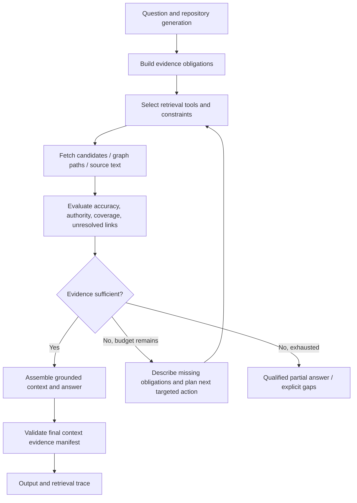

# Bounded Evidence-Driven Investigation Loop

## Why single-shot retrieval is an inadequate default for complex questions

A code question can require a sequence of discoveries: route → handler → service entry → branch → storage call → tests. A fixed `k=5` start and one graph-expansion pass cannot reliably guarantee that all required evidence will enter final context. Reported LightRAG controls showed both remote ranks for target symbols and graph-discovered code lost to a ~4,096-token budget.

**Proposed principle (not yet an accepted ADR):** Retrieval should stop when required evidence has been **assessed**, not merely because a fixed number of documents has been returned. Assessment can conclude sufficiently supported, partially supported, irrecoverably missing, or budget exhausted.

## Loop sketch

## Evidence ledger

Example: `What happens during small-repository ingestion?`

| Obligation | State | Candidate source | Follow-up |
| --- | --- | --- | --- |
| Ingestion request endpoint | Found / verified / absent | API route | Read handler and request validation |
| Repository acquisition / discovery | Unknown | Service topology and file traversal | Find call from handler |
| Language extraction | Unknown | Extractor entry points | Inspect dispatch and unsupported-language behavior |
| Graph assembly / resolution | Unknown | Canonical graph builder | Verify call relationships and persistence |
| Vector chunking/embedding | Unknown | Ingestion/vector adapter | Follow write side and retry contracts |
| State transitions and completion | Unknown | Lifecycle repository and tests | Inspect success/failure transitions |

Ledger states should distinguish **candidate located** from **source verified**, and **graph-predicted edge** from **implementation-confirmed call**. An evaluator must not mark an obligation met just because a documentation section mentions the same words.

## Evidence evaluator — two checkpoints

**Candidate checkpoint:** Does the retrieval set include high-authority evidence that can satisfy each obligation? Are symbol matches specific, source code genuine, generation consistent, and paths plausible? Did retrieved code come from production or examples?

**Final-context checkpoint:** After deduplication, chunk selection, and budgeting, does the *actual context given to the generator* still contain those snippets? The earlier LightRAG failure shows why evaluation cannot stop at candidate retrieval.

Potential signals: exact match and defining-node presence; source role; repository generation; resolved edge fraction; statement-to-source coverage; diversity of required stages; proof or uncertainty for each call edge. LLM judgments may supplement deterministic checks but must not replace verifiable link identities.

## Next-action selection

When a gap remains, choose the least expensive targeted move likely to close it:

- Missing named function: exact symbol lookup and source read.
- Missing adjacent callee: graph neighbor query, then verify actual implementation text.
- Missing edge through an unknown receiver: lexical call-site search, type/definition lookup; label unresolved if still uncertain.
- Missing broad lifecycle stage: structural inventory and known route/event identifiers, followed by selective semantic discovery.
- Documentation dominates: constrain or reweight candidate roles, but keep tests/docs as fallback and complementary proof.
- Relevant code lost to budget: allocate reserved evidence capacity, select smaller source passages, or retrieve a narrower proof, rather than merely raising global context size.

## Guardrails for an experiment

These are **candidate initial values**, not release settings:

- At most 3 investigative iterations.
- Bounded API calls, fetched source bytes, graph nodes and total tokens per query.
- Pinned repository + generation for every step. No silent cross-generation joins.
- Explicit permissions for source access; no mutation, writes, code execution, or re-ingestion by the retrieval loop.
- Stop on repeated frontier, no new evidence, exhausted budget, or adequate statement-level coverage.
- Record `query_id`, selected tools, constraints, cited nodes, unresolved edges, reason for each strategy change, and final-context manifest.
- Fallback to an honest partial answer rather than fabricating missing call edges.

## Two layers of loop ownership

1. **Internal RAG investigator:** Gradio/API users need a self-contained iterative retrieval answer path.
2. **External coding agent:** a coding assistant may already have its own loop. RAG-FOUNDRY-UNIVERSAL should expose high-value, bounded, typed discovery and navigation tools, not force a second autonomous planner underneath every tool call.

Share the retrieval primitives, evidence contract and traces. Avoid duplicated agent frameworks; evaluate whether the agent benefits when the loop stays entirely outside the RAG service.

## Risks and questions

- Multi-step exploration can amplify wrong graph relationships.
- A loop can increase cost while retrieving more irrelevant evidence.
- An LLM planner can steer toward familiar-but-incorrect code.
- Need a credible sufficiency criterion for broad causal questions, not only endpoint traces.
- Need tests for premature stop, endless search, contradictory evidence and generation races.

See [[06-Agent-Use-Cases-and-Issue-Evaluation]] for usage-driven success criteria.
