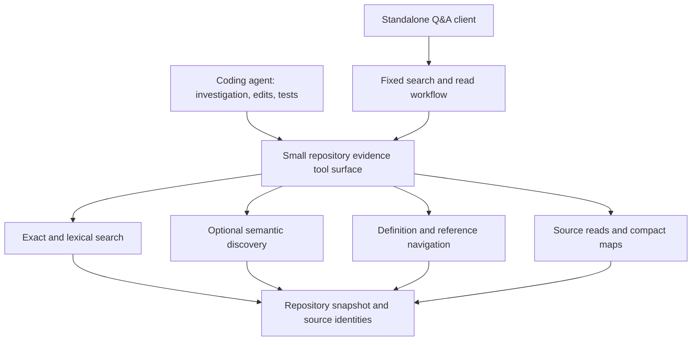

# Repository intelligence: architectural challenge and recommendation

> **Scope correction, November 12:** The owner subsequently clarified that the
> immediate investigation must diagnose existing retrieval failures before
> recommending an architecture or testing product positioning. The recommendation
> below is retained as the earlier discussion, not the current next-step plan.
> Start with the [matched retrieval-mechanism diagnostics](/DOCS/test_results/2026-11-12-retrieval-mechanism-diagnostics.md).

## Recommendation

**Design primarily for an external coding agent that needs trustworthy, inexpensive access to repository evidence. Start with a small set of search, navigation and source-reading capabilities. Make enhanced single-pass retrieval a useful operation within that service. Require a measured benefit before adding a server-owned investigation loop.**

This recommendation follows the owner's explicit priority: coding-agent task completion first, standalone repository Q&A second. It is conditional: if the service cannot outperform an agent's normal search and file reads on task success or comparable-success cost, do not expand it merely to preserve the original architecture.

The current approach appears to make a consequential assumption: a few semantically similar chunks are a good starting point for most repository questions, and graph expansion can repair the omissions. The November 11 record supplies counterexamples. It does **not** show that vector retrieval is generally useless, that graphs are the wrong representation, or that an autonomous investigator is required.

If starting today, I would choose an evidence service whose source of truth is the exact repository snapshot, with lexical search and definition lookup as inexpensive access paths, optional semantic discovery, and graph navigation as a fallible accelerator. A capable coding agent would own investigation and patching. A standalone Q&A client could initially use a fixed search-and-read workflow over the same capabilities. This is a product and control-flow recommendation, not a proposal to rewrite the storage services.

Read the [experiment plan](/DOCS/evaluations/2026-11-12-repository-intelligence-strategy-experiments.md) for how this recommendation could be rejected.

## What the evidence establishes, and what it does not

The [November 11 record](/DOCS/notes/20261111-code-intelligence-retrieval-failure-evidence.md) is the primary local failure account. The November 12 package is a later synthesis, sometimes written without access to that record. This review read the documents; it did not reproduce the SQL, ranking probes, deployed requests or source traces.

| Evidence in the record | Supported inference | Overreach to avoid |
| --- | --- | --- |
| Expected LightRAG symbols have vectors but best chunk ranks range from 329 to 7,861 for one probe | The tested embedding/query/corpus combination cannot supply those symbols through top-five retrieval | All semantic retrieval is unsuitable for code |
| Relevant expanded code is discarded under the reported context cap | Candidate discovery and final evidence delivery are separate failure points | Increasing the cap alone solves understanding |
| API receiver calls terminate at placeholders | Some important navigation paths are unavailable to this graph | Every placeholder is an incorrectly unresolved internal call |
| A short prompt produces a confident answer about example code | Relevance and task-specific authority differ; generation can misinterpret evidence | Tests and examples should always be excluded |
| DeepWiki supplied more useful traces with acknowledged missing bodies | A stronger external reference is worth investigating | Its architecture, snapshot or general superiority has been established |

Three corrections affect strategy:

1. **“Indexing is fine” is too strong.** Existence of a symbol and vector does not establish source completeness, useful representation, correct spans or adequate granularity. The tested generations predate ADR-056. A fresh matched baseline is necessary before attributing all remaining errors to architecture. “Freshness is secondary” remains a hypothesis.
2. **The 69% placeholder rate is not an internal-call failure rate.** Legitimate dependencies, builtins, dynamic dispatch and missing internal resolution require separate denominators. Task-critical unresolved links matter more than the global percentage.
3. **The historical tests are development evidence.** Note 08 calls some already-discussed questions “held-out”; the self-repo and LightRAG examples cannot be independent held-out evidence for this strategy. Existing E1 cases have their own frozen purpose and must not be casually reused for tuning.

There are also documentary discrepancies: the November 12 synthesis calls some analysis Windows-side while the November 11 record attributes confirmed probes to Linux; deployment descriptions and `DOCS/status.md` do not align on every release fact. These prevent confident reconstruction of current production state. They do not invalidate the reported failure mechanisms. A future run must pin its own environment rather than choose the most convenient account.

## Assumptions to challenge

| Assumption | Why it may be wrong | Alternative and falsifier |
| --- | --- | --- |
| Semantic similarity should choose the starting point | Queries often describe API usage, while implementation uses terse internal names | Independent lexical, definition and semantic channels; reject extra channels if task success does not improve |
| Every query needs an intent classifier | Misclassification can suppress the only useful source, and exact anchors can be handled directly | Small parallel search followed by verified reads; compare against classification at equal cost |
| Better ranking is sufficient | A perfect ranking cannot supply a passage absent from its candidate pool; whole functions may be the wrong delivery unit | Measure discovery and passage coverage separately |
| A graph path explains execution | Branch conditions, values, callbacks, configuration and HTTP boundaries can change behavior | Treat paths as hypotheses; demand source witnesses and conditions for causal claims |
| More resolved edges necessarily help | False precision can steer an agent more confidently to the wrong target | Compare graph-enabled and graph-disabled agents; score incorrect consequential claims |
| Examples and tests are contamination | They can expose the public vocabulary, intended behavior and reproduction entry points | Use them as bridges to definitions, and as behavioral evidence where appropriate |
| Evidence obligations can certify completeness | A planner may omit the decisive obligation and then mark its own checklist complete | Use task-specific evaluation rubrics and explicit unknowns; do not treat self-assessment as proof |
| A loop is needed because single-pass failed | The failed baseline lacks strong independent discovery and useful passage allocation | Compare adaptation against a strong fixed workflow with the same tools and budget |
| A single canonical graph must represent everything | Configuration, source, traces and working-tree edits have different validity conditions | Preserve canonical identity but permit explicitly scoped evidence views; avoid forcing runtime observations into static call truth |
| The service should own understanding | An external coding agent already reasons over files, tests and changes | Service supplies source evidence; test whether delegated reasoning adds value or hides errors |
| A committed index is sufficient for coding agents | Agents edit files; the index can describe yesterday's code during today's patch | Include working-tree mismatch tasks; either reject stale results or use an explicit revision-aware overlay |

These are reasons to test alternatives, not findings that each alternative will win.

## The three architectural alternatives

### 1. Enhanced single-pass retrieval

Interpret “single-pass” as one fixed retrieval workflow, possibly with several deterministic stages. Otherwise it is unfairly restricted to one vector query.

Proposed flow: resolve explicit anchors and run lexical/semantic discovery in parallel; keep channel provenance; deduplicate at symbol/file level; read selected definitions and bounded surrounding context; optionally expand verified relationships; select source passages; return evidence or generate an answer. Query-aware role preferences should remain soft unless the user explicitly restricts scope.

Rank fusion is a candidate mechanism, not the architecture's guarantee. Several channels may repeat the same wrong candidates. Exact definition matches can be protected separately rather than diluted by fusion scores. Useful contextual excerpts need the enclosing signature, branch predicate and relevant state dependencies, not just a matched call line.

**Best case:** explicit identifiers, local implementation questions, errors with searchable strings, and low-latency Q&A. It is the strongest inexpensive challenger to a loop.

**Failure case:** the first read reveals an unknown identifier or configuration choice that changes what must be searched next. A fixed workflow can anticipate common branches, but a wider one-shot candidate pool may waste its budget.

**Decision:** prefer this for standalone Q&A unless adaptation produces additional correct answers at an acceptable cost. Its evidence-returning form may also be a valuable agent tool.

### 2. Adaptive retrieval

Proposed flow: choose an initial search; inspect source; maintain unresolved questions; select a targeted follow-up; stop on adequate support, exhausted resources or lack of progress. The important capability is choosing a new action from observed evidence. BFS versus DFS is usually a smaller decision than choosing which symbol, configuration value, test or file to inspect.

**Best case:** questions where later search terms are unknowable until earlier source is read, or where competing explanations require different evidence.

**Failure case:** a wrong initial hypothesis narrows every subsequent search; the planner validates its own assumptions; repeated summaries discard conditions; a nested investigator consumes the external agent's budget without advancing the patch.

Controls should include explicit missing-evidence records, a source-preserving transcript, non-progress termination, and total cost accounting. A self-reported sufficiency score is not an acceptance metric. The small generator used in the reported runs also needs an oracle-evidence test before assigning it planning and verification roles.

**Decision:** conditional specialization. Buy this complexity only for demonstrated residual failures after a strong fixed workflow. If built later, keep it an optional high-level operation rather than an invisible loop beneath every primitive tool.

### 3. Agent-oriented repository intelligence

Proposed flow: the coding agent chooses when to search, navigate and read; the service returns bounded evidence with source locations and revision identity; the agent combines it with its local tests, debugger and edits.

**Best case:** issues requiring diagnosis, change planning, patching and regression testing, where the external agent already owns an investigation loop. Potential distinctive value comes from accurate references, compact repository orientation, repeated-query speed, or access to a repository beyond the local checkout.

**Failure case:** a large menu of awkward tools merely duplicates `rg` and file reads; results are stale after edits; graph certainty is overstated; network round trips cost more than local navigation. Exposing APIs does not itself improve agent performance.

Use a small capability surface: search with explicit modes, resolve definitions/references, read source ranges with optional surrounding structure, and request a bounded repository map. Return ambiguity and unsupported coverage alongside results. Assess batching and response size through agent traces rather than inventing a tool for every graph operation.

**Decision:** preferred product direction, contingent on incremental value over ordinary tools. A validated minimal toolset is sufficient; a full autonomous internal investigator is not a prerequisite.

| Criterion | Enhanced single-pass | Adaptive retrieval | Agent-oriented tools |
| --- | --- | --- | --- |
| Who chooses follow-up searches? | Fixed policy | Service planner | Coding agent |
| Main potential advantage | Predictable cost, broad initial recall | Evidence-dependent discovery | Direct integration with diagnosis and patching |
| Main new risk | Missing unforeseen dependencies | Compounding reasoning errors and cost | Duplication, poor tool usability, stale snapshots |
| Standalone Q&A | Natural fit | Natural but more expensive | Requires a thin answer client |
| Primary experiment | Beats current retrieval with fixed resources | Beats strong fixed retrieval at equal resources | Beats the same agent without the service |

These are partly orthogonal. Search quality, loop ownership and tool interface should be tested separately. Selecting agent-oriented tools does not mean abandoning a strong single-pass operation.

## Alternatives underweighted in the notes

### File-first localization and repository maps

Locate a subsystem or file before ranking tiny passages. Give the model a compact structural map, read a few likely files, and refine to symbols only after seeing context. This may preserve relationships that isolated chunks lose. It may also favor large familiar-looking files and consume more tokens; compare it against passage-first retrieval at the same evidence budget.

Aider documents a budgeted repository map containing important symbols and signatures, selected using graph ranking. That is a useful existence proof for a compact orientation mechanism, not evidence that its ranking will solve our tasks. [Aider repository map](https://aider.chat/docs/repomap.html).

### A fixed localization workflow without a general planner

A staged workflow—repository map, file localization, source read, evidence extraction—offers a middle ground between vector-first retrieval and autonomous investigation. Agentless demonstrates that fixed localization/repair/validation stages were competitive in its historical SWE-bench Lite setting. Its reported result is not a current ranking or a prediction for our languages and models. [Agentless paper, 2024](https://arxiv.org/abs/2407.01489).

### Minimal local navigation, possibly no persistent semantic index

For small repositories or infrequent queries, filesystem search plus source reads and available language navigation may be sufficient. Persistent indexing must earn its ingestion, freshness and operating costs. Include a baseline with no vectors and no stored call graph. If it wins, reducing the service's scope is a valid architectural result.

### Query-time bridges and selective semantic resolution

An unresolved receiver does not require rebuilding the entire graph before proceeding. Search the method name, inspect imports, annotations and assignments, enumerate plausible definitions, and disclose ambiguity. For repeated difficult navigation, compare this with a language server or offline semantic index. SCIP supports navigation information such as definitions and references; it does not supply a complete execution trace. [SCIP protocol repository](https://github.com/scip-code/scip).

The [SCIP addendum](./2026-11-12-scip-semantic-enrichment-and-graph-evidence-strategy.md) is directionally plausible but its value is unmeasured. First measure the headroom from manually supplying the correct task-critical definitions. If even that does not improve tasks, a multi-language indexing integration is premature. Runtime evidence can remain a separately scoped attachment; requiring a generalized evidence schema now risks solving a future data-model problem before a current product problem.

### Behavior and change evidence

For diagnosis, a failing test, stack trace, configuration value or recent diff may localize the issue more effectively than an implementation explanation. An external agent can gather these in its authorized sandbox and use the service to navigate from them. Test execution remains outside this read-only service. Evaluate data dependencies, error paths and configuration, not only call chains.

### Derived maps, summaries and larger context

Generated subsystem summaries could bridge natural language to implementation, but they can become stale or merely repeat documentation. Treat them as discovery aids with source links, not authoritative evidence. Likewise, moderately larger context or whole-file reading may beat sophisticated excerpt selection. Test these as controls before committing to expensive indexing or selection machinery. Charge summary construction and refresh costs to the comparison.

## Architecture I would choose today

The diagram describes responsibilities, not new deployment units. Reuse the existing service boundaries and persistence while testing the mechanism. Original source is the final evidentiary reference; an index helps find it. A result should identify repository revision/generation, file and range, content identity, retrieval method, truncation, and relevant uncertainty. A graph-derived candidate is distinguishable from a verified definition.

For an editing agent, the relationship between the indexed snapshot and the current working tree must be explicit. The first candidate can simply report mismatches and fall back to local reads. A changed-file overlay is an alternative to evaluate, not an immediate schema commitment.

The human-facing Q&A client should use the same source and evidence conventions, with its own answer-quality checks. Add a bounded loop there only if residual failures require it. General engineering guidance also distinguishes fixed workflows from model-directed agents and recommends increasing complexity only when warranted; that is supporting rationale, not a benchmark of this system. [Anthropic, Building effective agents](https://www.anthropic.com/research/building-effective-agents).

Retain PostgreSQL for this investigation. A database change becomes relevant only if a demonstrated useful operation is too slow under measured workload. Better graph storage cannot supply missing semantic facts or select missing evidence.

## What would change the recommendation?

- If normal coding tools match the service on success and cost, shrink or pause the agent-tool product direction.
- If a fixed workflow with broader discovery and better reads matches adaptation, choose the fixed workflow.
- If an internal investigator consistently improves patch success over primitive tools at matched total budgets, offer that operation to agents despite the initial preference for external loop ownership.
- If the generator fails with reviewed sufficient evidence, improve model/task fit before attributing failures to retrieval architecture.
- If oracle relationship repair yields large downstream gains and selective indexing reproduces them affordably, prioritize semantic resolution.
- If benefits only appear on explicit endpoint traces, limit the product claim; do not extrapolate to debugging, impact analysis or multilingual understanding.

## Decision and review handoff

This document and the [experiment plan](/DOCS/evaluations/2026-11-12-repository-intelligence-strategy-experiments.md) complete a desk investigation, not an empirical architecture selection. No implementation, deployments, corpus changes, GitHub issue creation or milestone changes occurred as part of this review.

For the owner's related Claude Code investigation, useful independent challenges are:

1. Make the strongest case that a fixed file-first workflow beats this tool-service recommendation.
2. Identify which reported failures would remain with perfect discovery, perfect graph navigation, or perfect final passages respectively.
3. Name a task where the service adds information or saves work unavailable through ordinary local tools.
4. Challenge the proposed experiment budgets, stop rules and definition of successful diagnosis.
5. Assess whether working-tree freshness makes a remote committed-snapshot service a poor fit for the primary use case.

Independent reviews are more informative if each author records an initial recommendation before reading the other's conclusions. Compare disagreements as falsifiable claims; agreement between two assistants is not validation. The owner coordinates this review; no message was sent to Claude Code.

Next decision: select the smallest investigation stage and approve its proposed evaluation contract. Before any prototype or harness implementation, reconcile existing work (including #342, E1 and ADR-055), create or select the relevant GitHub issue and milestone, and obtain the explicit architectural/spec decision appropriate to the change. Existing accepted decisions remain in force until deliberately amended.
